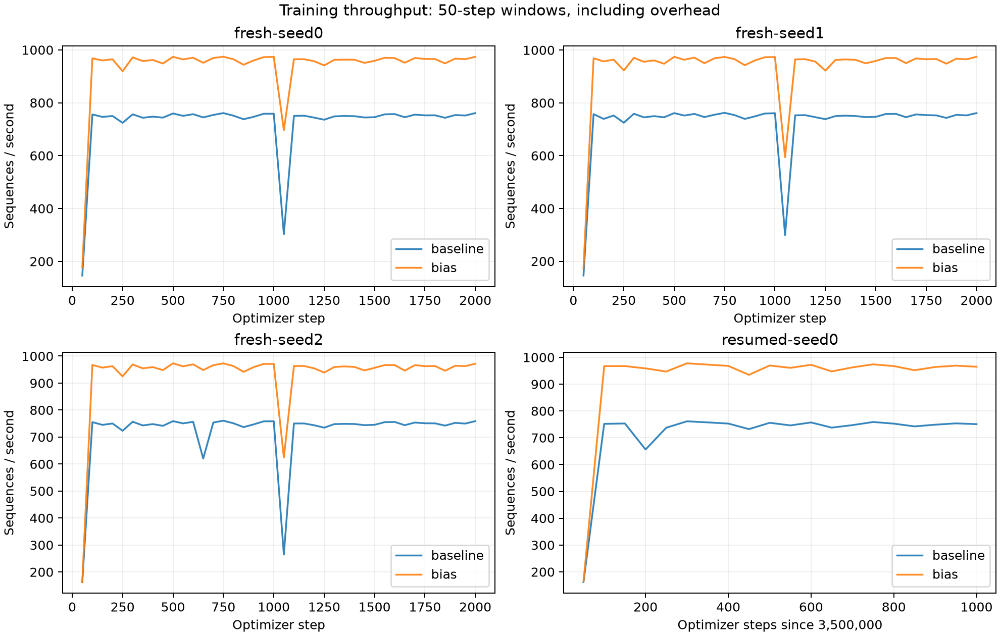
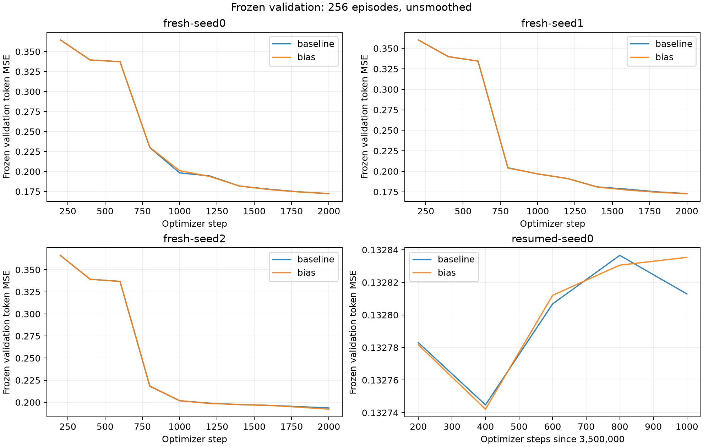
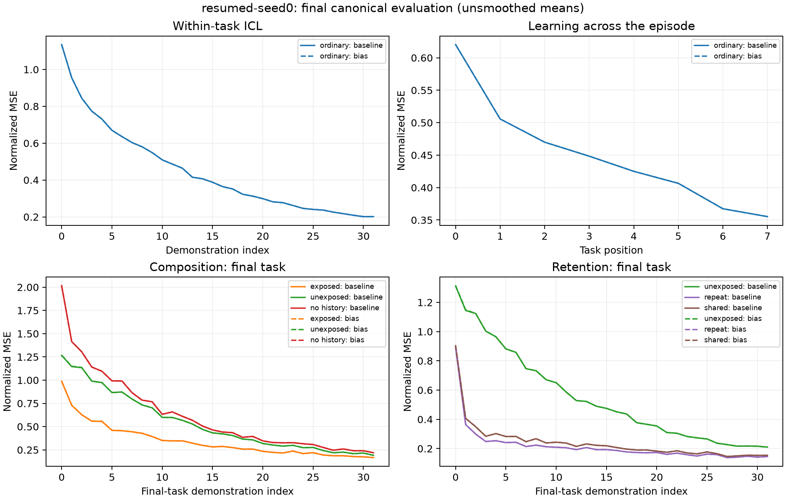
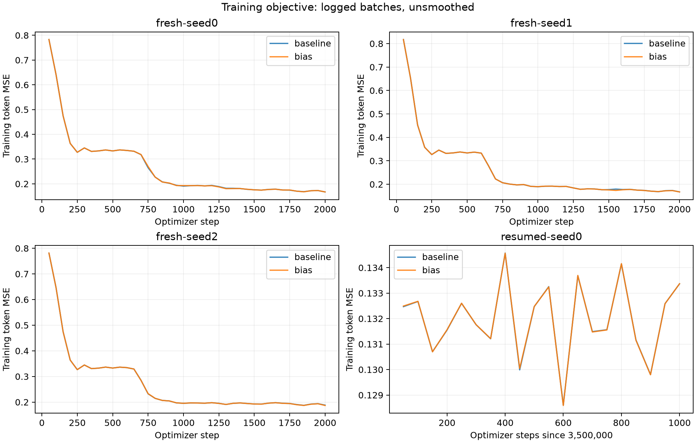
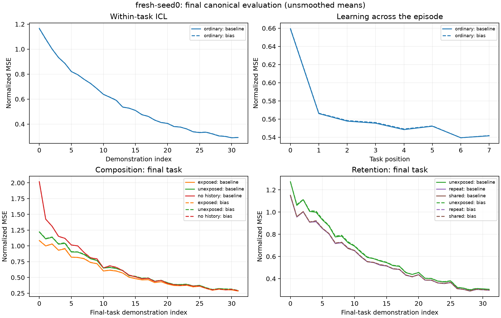
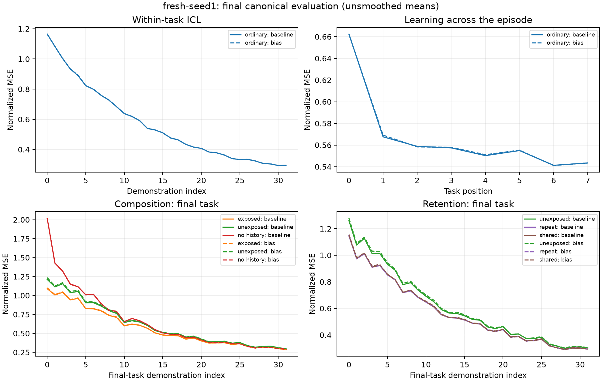
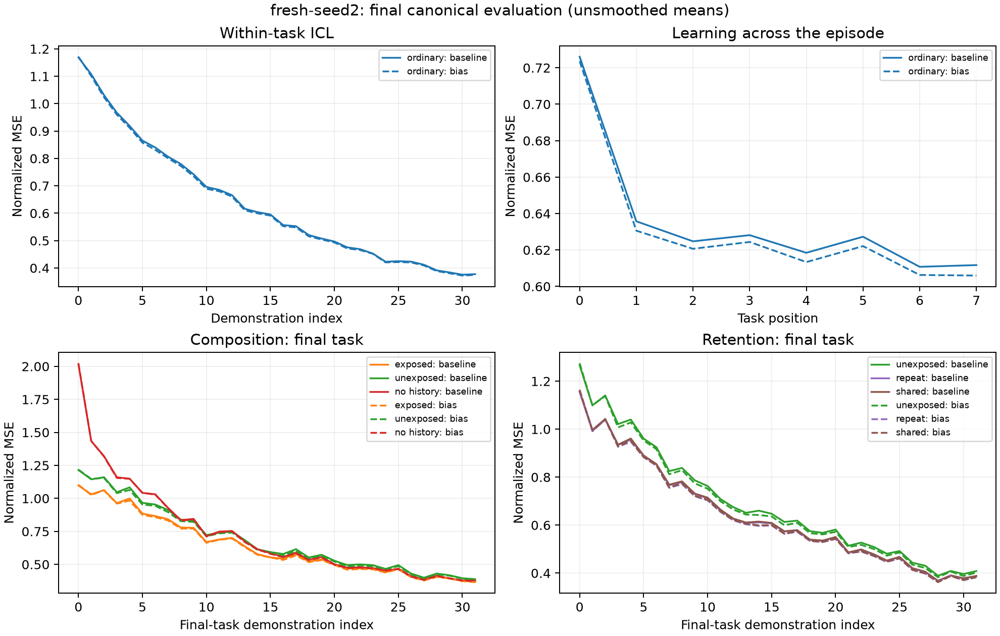

# Training performance and fidelity investigation

2026-10-29 · Isambard GH200 · branch `codex/training-performance-parity`

The bias lookup is the candidate supported by this investigation. Replacing
`self.bias[token_type]` with `F.embedding(token_type, self.bias)` increased steady
training throughput by approximately **28%**, equivalent to **22% less time per
training step**, while passing the predefined FP32 and BF16 numerical checks.
Three paired fresh training runs and a paired continuation from 3.5M steps passed
the final-validation criterion. They did not produce identical learning trajectories.

The larger projection and length-grouping experiments reached up to 2.21× device
throughput but failed the FP32 criteria. They remain experimental controls and are
not part of the proposed production calculation.

The independent W&B resume extraction is published as
[PR #31](https://github.com/james-harvey-git/iccl-analysis/pull/31), based directly
on main and containing no linear-decoding features. Neither that PR nor the
performance changes have been merged. The original training-launch branch,
`codex/resume-training-wandb` at `868f59a`, remains unchanged.

## Question and experimental logic

The study asks three separate questions:

1. Can the embedding or padding work be reduced without changing the mathematical
   calculation, training data, objective, parameters, or optimizer schedule?
2. Do those mathematically equivalent calculations preserve numerical behavior on
   the actual CUDA training stack, including a trained checkpoint?
3. Does any candidate that passes those checks improve real training throughput
   while retaining the observed learning and canonical capabilities?

The [protocol](training-performance-protocol.md) defines the numerical limits and
the final-validation limit before the GPU experiments. The limits were not widened
after failures. Baseline controls use main's indexed embedding at `4f49da4`;
the selected candidate keeps its weight projection unchanged. Both use the
ordinary `Trainer.fit`, with the same indexed data stream, batch size, pooled
masked MSE, AdamW, scheduler, validation, and capability reporting.

The runtime change is confined to [TokenEmbedding](../src/iccl/models/model.py).
`F.embedding` selects the same bias rows. Its defaults retain dense gradients,
with no padding exclusion, frequency scaling, or norm modification
([PyTorch 2.11 documentation](https://docs.pytorch.org/docs/2.11/generated/torch.nn.functional.embedding.html)).
Parameter names, shapes, ordering, initialization, checkpoint loading, and bias
weight-decay exemption are preserved. The backward accumulation order can differ.

## Numerical checks

Each CUDA comparison uses an identical batch of 128 episodes and identical starting
model/optimizer state. Tests cover one fresh batch and the first continuation batch
from the full 3.5M-step checkpoint, each in FP32 and BF16. Batch hashes are retained.
Fresh AdamW uses the actual warmup learning rate, `3e-7`; continuation restores
`3e-4`, optimizer moments, and scheduler state.

Relative RMS means `norm(candidate - baseline) / norm(baseline)`. For parameter
updates, the compared quantity is the change from the starting parameters, rather
than the much larger parameter tensor itself. Predictions are compared on real
tokens; the loss uses the unchanged prediction mask.

| Bias candidate comparison | Predictions and loss | Largest parameter-gradient relative RMS | Whole-model update relative RMS |
|---|---|---:|---:|
| Fresh, FP32 | Bit-exact | 6.33e-7 | 2.40e-7 |
| Fresh, BF16 | Bit-exact | 5.56e-7 | 2.91e-7 |
| 3.5M checkpoint, FP32 | Bit-exact | 2.90e-6 | 2.32e-7 |
| 3.5M checkpoint, BF16 | Bit-exact | 3.47e-6 | 6.44e-8 |

Every parameter gradient except `embed.bias` was bit-exact in these comparisons.
All prescribed checks passed. The repeated baseline was bit-exact in both
precisions and both starting states. The largest bias-gradient absolute difference
was `4.88e-4` at initialization, where its relative difference was `6.33e-7`;
the trained-state maximum was `2.42e-9`. Full per-parameter errors, absolute
maxima, losses, thresholds, and provenance are in the
[fresh](training-performance/2026-10-29/numerical-and-timing/numerical-fresh/numerical.json)
and [continuation](training-performance/2026-10-29/numerical-and-timing/numerical-resumed/numerical.json)
records.

Additional validation:

- Performance branch: **245 CPU tests passed**, including embedding/full-model
  gradient checks, golden-stream regression, and checkpoint continuation.
- Final Isambard CUDA FLA/reference forward/backward checks: **2 passed**
  ([log](training-performance/2026-10-29/final-cuda-tests.log), job `7831966`).
- A disposable copy of the original launch branch with the same final embedding
  change: **286 CPU tests passed**; its 19 CUDA-marked tests were deselected.
- Ruff, formatting, and Pyright passed. The original launch checkout was not edited.

These results establish the tested numerical tolerances, not bitwise identity of
future optimizer trajectories on every device or software version.

## Measured speed

The controlled timing uses BF16, batch size 128, the actual variable-world data,
eight identical device-resident batches, warmed sequence shapes, and three timed
passes. Each variant starts from the same trained model and optimizer state.
The timed step includes forward, loss, backward, ordinary AdamW, gradient norm,
scheduler, and the existing scalar bookkeeping. Loading data, evaluation, and
checkpoint I/O are assessed separately in the complete training runs.

| Calculation | Median step | Throughput relative to baseline | Numerical decision |
|---|---:|---:|---|
| Main baseline | 173.15 ms | 1.00× | Control |
| **Bias lookup only** | **135.03 ms** | **1.28×** | **Pass FP32 and BF16** |
| Typed-feature projection | 91.17 ms | 1.90× | Fail FP32 |
| Typed-feature projection, two length groups | 78.46 ms | 2.21× | Fail FP32 |
| Typed-feature projection, four length groups | 100.75 ms | 1.72× | Fail FP32 and fresh BF16 update |
| Project every token type, then select | 91.98 ms | 1.88× | Fail FP32 |
| Bias lookup, two length groups | 108.00 ms | 1.60× | Fail FP32 |
| Project every type, two length groups | 78.85 ms | 2.20× | Fail FP32 |

The repeated baseline was 173.74 ms, within 0.35% of the first measurement.
Peak allocated memory was effectively unchanged by the selected candidate:
16.918 GB versus 16.919 GB, in decimal units. It is a speed improvement, with no
demonstrated full-model memory saving. All three timing samples per variant are in
the [timing record](training-performance/2026-10-29/numerical-and-timing/timing/benchmark.json).

The ordinary training loop corroborated the device timing:

| Paired run | Median sequences/s, baseline → bias | Complete `Trainer.fit`, baseline → bias | Fit speedup |
|---|---:|---:|---:|
| Fresh seed 0, 2,000 steps | 750.2 → 964.5 | 426.3 → 335.3 s | 1.272× |
| Fresh seed 1, 2,000 steps | 752.0 → 964.7 | 426.0 → 336.0 s | 1.268× |
| Fresh seed 2, 2,000 steps | 750.3 → 962.7 | 426.6 → 336.6 s | 1.267× |
| 3.5M → 3.501M, 1,000 additional steps | 751.8 → 967.1 | 240.3 → 200.9 s | 1.196× |

Median throughput excludes the first 50-step startup window. The remaining windows
include periodic validation/monitor/checkpoint work that falls inside them.
Complete fit time also includes startup and terminal reporting/checkpoints, but
excludes the extra post-study rescore. Its speedup is therefore smaller, especially
for the short continuation. These are short single-GPU measurements on GH200,
not a guaranteed walltime saving on EIT H100 or a multi-million-step run.



## Learning and capability preservation

The three fresh pairs vary model initialization seeds 0, 1, and 2 while keeping
the indexed data seed at 0. Each pair sees the same episodes in the same order.
The continuation pair restores the same full training state at step 3,500,000,
including 448,000,000 consumed samples. It runs to **3,501,000 total steps**.

Validation token MSE averages squared error over output dimensions, then pools
the 73,072 prediction tokens in 256 frozen episodes. Positive differences below
mean higher error for the bias candidate. The predefined endpoint criterion was
an absolute relative difference of at most 1% for every pair.

The intervals resample **whole paired episodes**, using 10,000 bootstrap draws
with seed 0 and percentile 95% endpoints. They describe variation across frozen
evaluation episodes conditional on the trained models. They do not quantify
training-seed uncertainty or uncertainty about millions of future updates.

| Pair | Baseline final MSE | Bias final MSE | Relative difference | Paired 95% interval |
|---|---:|---:|---:|---:|
| Fresh seed 0 | 0.172246 | 0.172433 | +0.109% | [+0.072%, +0.145%] |
| Fresh seed 1 | 0.172843 | 0.172721 | −0.070% | [−0.125%, −0.015%] |
| Fresh seed 2 | 0.193584 | 0.192272 | −0.678% | [−0.746%, −0.607%] |
| Trained continuation | 0.132813 | 0.132835 | +0.0169% | [+0.0045%, +0.0291%] |

All eight runs reached their targets with finite parameters. All four final
comparisons passed the 1% criterion. Several intervals exclude zero: the outcome
is small, measurable differences, rather than statistical indistinguishability.



The important exception to a uniform 1% claim is fresh seed 0 at step 1,000:
the candidate's validation error was **1.40% higher**. The 1% criterion applies to
the final checkpoint, and the intermediate curves are reported rather than hidden.
The continuation panel uses a narrow vertical scale; its visible separation is
small in absolute MSE.

Canonical evaluation uses 256 episodes per condition at eight modules, eight
tasks, and 32 demonstrations per task. Normalized MSE divides each task's output
MSE by its mean output variance. ICL averages across tasks and demonstrations;
composition and retention condition means use the final task. The displayed
curves are unsmoothed means. Detailed paired episode intervals are retained in
the [analysis summary](training-performance/2026-10-29/analysis/summary.json).

The curves retain the same qualitative learning patterns and condition ordering.
They are not numerically identical:

- Across fresh runs, the largest absolute condition-mean difference was 0.00823
  normalized MSE (seed 2, retention/unexposed). The largest individual curve-point
  difference was 0.02268 (seed 1, composition/unexposed, demonstration index 0).
- For the trained continuation, the largest condition-mean difference was 0.000387
  normalized MSE (composition/exposed). The largest curve-point difference was
  0.004682 (retention/unexposed, demonstration index 1).
- Small differences between conditions can consequently change appreciably in
  relative terms. This study does not establish identical learned representations
  or mechanistic interpretations.



<details>
<summary>Training objective and all fresh capability comparisons</summary>

Training objective points show the last training batch at each 50-step logging
boundary; they are not 50-step average losses.






</details>

## Why the larger changes were rejected

Typed-feature and all-type projections preserve the real-valued affine expression,
but reassociate its floating-point calculation. On the trained checkpoint their
embedding relative RMS difference was only `6.57e-8`; full-model FP32 prediction
relative RMS reached `1.734e-3`, with maximum absolute difference `0.08136`.
That exceeds the prediction limit `5e-5`. Fresh FP32 optimizer-update differences
also reached about 1.5%, exceeding the 0.1% limit.

Changing batch grouping likewise changes numerical execution. Even bias-only
plus two groups failed FP32. Four groups additionally failed the fresh BF16
update limit: 3.184% versus the allowed 2%, while being slower than two groups.

The projection and two-group variants did pass the BF16 checks, but accepting
them would weaken the prescribed FP32 contract. No learning runs were used to
override those numerical failures. A precision probe found that disabling CuDNN
TF32 did **not** remove the discrepancy; matmul TF32 was already disabled.
The exact downstream source of amplification remains unresolved
([probe record](training-performance/2026-10-29/numerical-and-timing/precision-probe/precision-probe.json)).

## Scope of a subsequent integration

The evidence supports integrating the bias lookup and its regression coverage,
subject to the user's review. The runtime change does not require a new config
setting or a checkpoint conversion. The experimental variants and benchmark
machinery need not become production paths.

The current launch branch was compatibility-tested in a separate disposable
checkout. It can receive the same small model change without importing the
investigation harness or changing its decoding/resume features. The W&B resume
PR is independent and has its own 242 passing CPU tests plus clean static checks;
its W&B interactions were mocked, rather than applied to an active production run.

Remaining limits are explicit: three fresh initialization seeds for 2,000 steps,
one trained checkpoint for 1,000 additional steps, one CUDA stack, and the
validation plus seven canonical monitor conditions. The full 543-suite bundle
was generated and validated, but the complete generalization/retention-factorial
sweep was not rescored. Long-run representation equivalence, other model sizes,
H100/MPS performance, and all-platform numerical parity are unverified.

<details>
<summary>Provenance, saved evidence, and reproduction</summary>

- Hardware: NVIDIA GH200 120GB, one GPU per job, eight allocated CPUs.
- Runtime: PyTorch `2.11.0+cu128`, Triton `3.6.0`, `fla-core 0.5.2`, TileLang
  `0.1.14`. BF16 training; FP32 parameters; matmul TF32 disabled.
- Model: four GDN layers, width 256, four heads, feed-forward width 1024,
  value expansion 2, short convolution size 4. Batch 128, four data-loader workers,
  AdamW learning rate `3e-4`, 1,000-step warmup, constant schedule, decay `0.003`.
- Logging every 50 steps, validation every 200, canonical monitor every 1,000;
  final weights and full training checkpoints retained.
- Main baseline: `4f49da4e272bd39ccdb41e10bd1c316cc6343fae`.
- Baseline training harness: `ebc961c1d24c3dd63c9d83890b79dafab1d52f23`.
- Final numerical/timing harness: `3096371047aa72b8cc9f3ef4a19bc84ff3842f01`.
- Candidate training and final CUDA tests: `647b318a2991a60a04f4086b1e3bc201e17cc05f`.
- Full starting checkpoint SHA-256:
  `d5c248eff34be1409c745f64428e72f1c6ba3063df2d91032b64979b90dcdfb0`.
- GPU jobs: numerical/timing `7830742`, alternatives/probe `7831753`, baseline
  array `7831361`, candidate array `7831886`, final CUDA checks `7831966`.
  All completed; at most five study GPUs were allocated concurrently.
- The private evaluation bundle was built by CPU job `7830740`. An initial
  preflight correctly rejected an obsolete existing bundle; no production data
  or environment was overwritten.

W&B group: `training-performance-parity-20261029` in
`jublett-university-of-oxford/iccl-analysis`. All eight runs were verified finished
through the API, with the intended terminal step and populated validation history.

| Pair | Baseline | Bias candidate |
|---|---|---|
| Fresh seed 0 | [l6e0kmp1](https://wandb.ai/jublett-university-of-oxford/iccl-analysis/runs/l6e0kmp1) | [at4jvhg0](https://wandb.ai/jublett-university-of-oxford/iccl-analysis/runs/at4jvhg0) |
| Fresh seed 1 | [kdjfjlhk](https://wandb.ai/jublett-university-of-oxford/iccl-analysis/runs/kdjfjlhk) | [cwzc9m71](https://wandb.ai/jublett-university-of-oxford/iccl-analysis/runs/cwzc9m71) |
| Fresh seed 2 | [i6gd3ew8](https://wandb.ai/jublett-university-of-oxford/iccl-analysis/runs/i6gd3ew8) | [lbgz03gm](https://wandb.ai/jublett-university-of-oxford/iccl-analysis/runs/lbgz03gm) |
| Trained continuation | [16s75dfa](https://wandb.ai/jublett-university-of-oxford/iccl-analysis/runs/16s75dfa) | [o2vquqml](https://wandb.ai/jublett-university-of-oxford/iccl-analysis/runs/o2vquqml) |

The browser session was unauthenticated, so the rendered W&B workspace layout
remains unverified. The local comparison plots were inspected visually. The
continuations used new study runs; the production W&B run was not resumed.

Versioned evidence lives under `docs/training-performance/2026-10-29/`: full
numerical/timing JSON, precision probe, every run's history/config/provenance,
final curve and summary CSVs, analysis summary, and figures. The
[evidence manifest](training-performance/2026-10-29/evidence-manifest.json)
contains SHA-256 hashes and records the historical variant-name mapping:
`optimized` → `typed_features`, `group2` → `typed_features_group2`,
`group4` → `typed_features_group4`. Raw results retain their original names.
Versioned CSV copies use LF line endings; the original exports are also retained.

Full local evaluation arrays and histories are preserved in the investigation
worktree's ignored `outputs/training-performance-20261029/` directory (about
56 MB). The remote study, including full checkpoints and the frozen bundle, is at
`/scratch/u6oz/jharvey.u6oz/iccl-analysis/training-performance/20261029` on Isambard.
Each run has a `final-evaluation/step_*/manifest.json` defining array schema,
metric definitions, and suite provenance. Large checkpoints/data are not in Git.

To regenerate the report's analysis from the complete local evidence:

```bash
uv run python scripts/analyze_training_performance.py \
  outputs/training-performance-20261029 --candidate bias
```

The numerical/timing entry point is `scripts/benchmark_training.py`, dispatched
by `scripts/cluster/isambard/performance.slurm`; use `performance.mode=numerical`
or `benchmark`, and `performance.checkpoint=<full-state-file>` for the trained
case. Fresh checks omit that checkpoint. The paired training launcher is
`scripts/cluster/isambard/performance_trajectories.slurm`, with
`ICCL_PERF_CANDIDATE=bias` and isolated study, checkpoint, and evaluation paths.
It refuses to overwrite an existing trajectory. Preserve the recorded source
revisions and runtime when reproducing these particular numbers.

</details>
